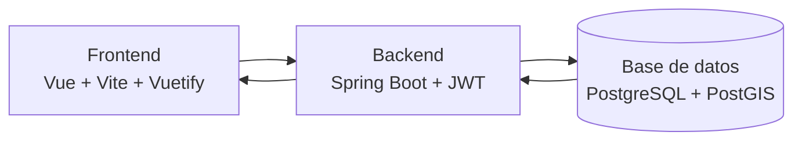

# Control 2 - Gestión de Tareas y Análisis Geoespacial

Este proyecto corresponde a la entrega del Control 2 de la asignatura BDA. Es una aplicación web para gestión de tareas con análisis geoespacial, usando PostgreSQL/PostGIS en el backend y Vue en el frontend.

## Arquitectura



## Contenedores

- `db`: PostgreSQL con PostGIS. Carga scripts de inicialización desde `infra/initdb`.
- `backend`: Spring Boot 21/4.0 que expone la API en `http://localhost:8080/api`.
- `frontend`: Vue 3 + Vite. Consume la API del backend desde `http://localhost:5173`.

## Tecnologías

### Backend

- Java 21
- Spring Boot 4.0
- Spring Data JPA
- Hibernate Spatial
- Spring Security con JWT
- Maven

### Frontend

- Vue 3
- Vite
- Vuetify
- Vue Router
- MapLibre GL
- pnpm

### Base de datos

- PostgreSQL
- PostGIS

### Infraestructura

- Docker
- Docker Compose
- Contenedores `db`, `backend` y `frontend`

## Cómo ejecutar

1. Ir a la carpeta de infraestructura:

   ```bash
   cd infra
   ```

2. Levantar toda la pila:

   ```bash
   docker compose up --build
   ```

3. Abrir la aplicación:

   - Frontend: `http://localhost:5173`
   - API: `http://localhost:8080/api`

## Flujo de arranque

1. `db` inicia primero y prepara la base de datos con PostGIS.
2. `backend` se conecta a `db`, levanta la API y deja disponibles los endpoints REST.
3. `frontend` instala dependencias con `pnpm`, corrige permisos de binarios si hace falta y arranca Vite.

## Sobre el frontend en Docker

El frontend se arranca con esta receta:

```yaml
command: sh -c "corepack enable && pnpm install --ignore-scripts --config.confirmModulesPurge=false && find node_modules/.pnpm -path '*/bin/*' -type f -exec chmod 755 {} + && pnpm run dev --host 0.0.0.0 --port 5173"
```

Además, `node_modules` vive en un volumen nombrado separado:

```yaml
- frontend_node_modules:/app/node_modules
```

Eso evita que el árbol de dependencias del contenedor se mezcle con el del host.

Si el frontend falla en tu máquina pero a otros les funciona, el problema normalmente está en permisos de binarios generados por `pnpm` o en el estado del volumen local. Si quieres limpiar todo y partir desde cero:

```bash
docker compose down -v
docker compose up --build
```

Si necesitas borrar solo las dependencias del frontend:

```bash
docker volume rm infra_frontend_node_modules
docker compose up --build frontend
```

## Datos para pruebas

Para probar la aplicación usa el usuario de demo:

- `username`: `admin`
- `password`: `pass123`

Ese usuario sirve para probar autenticación, tareas pendientes, tareas completadas, estadísticas por sector y consultas espaciales con datos ya cargados.

## Pruebas sugeridas

La aplicación permite validar estas actividades:

- Registro de usuarios.
- Crear, editar, eliminar y listar tareas.
- Filtros y búsqueda sobre tareas.
- Notificaciones.
- Asociación de tareas a usuarios y sectores.
- Cantidad de tareas hechas por usuario y por sector.
- Tarea pendiente más cercana al usuario.
- Tarea más cercana al usuario que esté pendiente.
- Sector con más tareas completadas dentro de un radio de 2 km.
- Sector con más tareas completadas dentro de un radio de 5 km.
- Promedio de distancia de tareas completadas respecto a la ubicación del usuario.
- Agrupación espacial de tareas pendientes por concentración geográfica.

## API

**Base URL:** `http://localhost:8080/api`

> La API usa JWT y, en el login, también deja el token en una cookie. Para endpoints protegidos, agrega el header:
>
> `Authorization: Bearer <TU_TOKEN>`

### 1. Usuarios

#### Registrar usuario

- URL: `/api/users/register`
- Método: `POST`
- Body:

```json
{
  "username": "martin",
  "password": "password123",
  "longitude": -70.6483,
  "latitude": -33.4569
}
```

#### Login

- URL: `/api/users/login`
- Método: `POST`
- Body:

```json
{
  "username": "admin",
  "password": "pass123"
}
```

- Respuesta: `id`, `username` y mensaje de éxito. También setea la cookie del token.

#### Ayuda de login

- URL: `/api/users/login`
- Método: `GET`
- Respuesta: texto de ayuda para usar `POST /api/users/login`.

#### Listar usuarios

- URL: `/api/users?page=0&size=10`
- Método: `GET`
- Respuesta: página de usuarios.

#### Buscar usuario por ID

- URL: `/api/users/{id}`
- Método: `GET`

#### Buscar usuario por nombre

- URL: `/api/users/username/{username}`
- Método: `GET`

#### Usuario autenticado

- URL: `/api/users/me`
- Método: `GET`
- Requiere autenticación válida.

#### Cerrar sesión

- URL: `/api/users/logout`
- Método: `POST`
- Limpia la cookie del token.

#### Token CSRF

- URL: `/api/users/csrf`
- Método: `GET`
- Útil si necesitas leer el token CSRF expuesto por Spring.

### 2. Sectores

#### Crear sector

- URL: `/api/sectors`
- Método: `POST`
- Body:

```json
{
  "name": "Sector Centro",
  "wkt": "POLYGON((-70.66 -33.44, -70.64 -33.44, -70.64 -33.46, -70.66 -33.46, -70.66 -33.44))"
}
```

#### Listar sectores

- URL: `/api/sectors?page=0&size=10`
- Método: `GET`
- Respuesta: página de sectores.

#### Buscar sector por ID

- URL: `/api/sectors/{id}`
- Método: `GET`

#### Actualizar sector

- URL: `/api/sectors/{id}`
- Método: `PUT`
- Body: mismo formato que en crear sector.

#### Eliminar sector

- URL: `/api/sectors/{id}`
- Método: `DELETE`
- Si el sector tiene tareas asociadas, el backend responde conflicto.

#### Sector con más tareas completadas cerca del usuario

- URL: `/api/sectors/stats/top-sector/{userId}?radiusKm=2.0`
- Método: `GET`
- `radiusKm` es opcional.

#### Concentración de tareas pendientes por sector

- URL: `/api/sectors/stats/concentration`
- Método: `GET`

#### Sector por punto del mapa

- URL: `/api/sectors/point?lng=-70.665&lat=-33.528`
- Método: `GET`
- Devuelve el sector que contiene el punto, o `404` si no pertenece a ninguno.

### 3. Tareas

#### Crear tarea

- URL: `/api/tasks`
- Método: `POST`
- Body:

```json
{
  "title": "Limpiar plaza",
  "description": "Limpiar la plaza central",
  "dueDate": "2026-06-01",
  "status": "PENDING",
  "userId": 1,
  "longitude": -70.65,
  "latitude": -33.45
}
```

#### Listar tareas

- URL: `/api/tasks?page=0&size=10`
- Método: `GET`
- Respuesta: página de tareas.

#### Buscar tarea por ID

- URL: `/api/tasks/{id}`
- Método: `GET`

#### Actualizar tarea

- URL: `/api/tasks/{id}`
- Método: `PUT`
- Body: mismo formato que en crear tarea.

#### Eliminar tarea

- URL: `/api/tasks/{id}`
- Método: `DELETE`

#### Marcar tarea como completada

- URL: `/api/tasks/{id}/complete?userId={userId}`
- Método: `PATCH`

#### Asignar tarea a un usuario

- URL: `/api/tasks/{id}/assign?userId={userId}`
- Método: `PATCH`

#### Listar tareas por usuario

- URL: `/api/tasks/user/{userId}?page=0&size=10`
- Método: `GET`

#### Buscar tareas por filtros

- URL: `/api/tasks/filter?status=PENDING&sectorId=1&page=0&size=10`
- Método: `GET`
- `status` y `sectorId` son opcionales.

#### Buscar tareas por palabra clave o estado

- URL: `/api/tasks/search?status=PENDING&keyword=luz&page=0&size=10`
- Método: `GET`

#### Tareas cercanas a un punto

- URL: `/api/tasks/nearby?lng=-70.665&lat=-33.528&radiusKm=5.0&page=0&size=10`
- Método: `GET`

#### Tarea pendiente más cercana al usuario

- URL: `/api/tasks/closest/{userId}`
- Método: `GET`

#### Tareas hechas por usuario por sector

- URL: `/api/tasks/stats/user/{userId}`
- Método: `GET`

#### Tareas hechas por todos los usuarios por sector

- URL: `/api/tasks/stats/users-sectors`
- Método: `GET`

#### Promedio de distancia de tareas completadas

- URL: `/api/tasks/stats/average-distance/{userId}`
- Método: `GET`

### 4. Notificaciones

#### Notificaciones activas de un usuario

- URL: `/api/notifications/user/{userId}`
- Método: `GET`
- Devuelve las notificaciones no leídas ordenadas de más reciente a más antigua.

#### Marcar notificación como leída por tarea

- URL: `/api/notifications/task/{taskId}/read`
- Método: `PATCH`

## Ruta rápida de pruebas

Si quieres probar todo de forma ordenada, sigue este flujo:

1. Hacer login con `admin / pass123`.
2. Verificar el usuario autenticado con `/api/users/me`.
3. Listar usuarios con `/api/users?page=0&size=10`.
4. Listar sectores con `/api/sectors?page=0&size=10` y probar `/api/sectors/point`.
5. Crear una tarea con `/api/tasks` y luego buscarla con `/api/tasks/{id}`.
6. Probar filtros con `/api/tasks/search`, `/api/tasks/filter` y `/api/tasks/nearby`.
7. Marcar una tarea como completada con `/api/tasks/{id}/complete?userId={userId}`.
8. Revisar estadísticas con `/api/tasks/stats/user/{userId}`, `/api/tasks/stats/users-sectors`, `/api/tasks/stats/average-distance/{userId}` y `/api/sectors/stats/top-sector/{userId}`.
9. Revisar notificaciones con `/api/notifications/user/{userId}` y marcarlas leídas con `/api/notifications/task/{taskId}/read`.

## Ejemplos de uso en pruebas

Puedes probar rápido así:

1. Hacer login con `admin / pass123`.
2. Copiar el token JWT si el endpoint lo devuelve.
3. Consultar tareas por usuario con `/api/tasks/user/1`.
4. Revisar la tarea pendiente más cercana con `/api/tasks/closest/1`.
5. Revisar el sector con más completadas con `/api/sectors/stats/top-sector/1`.
6. Revisar el promedio de distancia con `/api/tasks/stats/average-distance/1`.

## Notas de implementación

- Las consultas geoespaciales usan PostGIS.
- Las notificaciones están integradas en la lógica de negocio del backend.
- Para más detalle técnico, revisar los controladores en `backend/control2/src/main/java/com/example/control2/controller/`.
